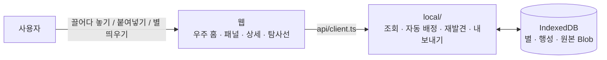

# 🌌 SpaceLog

> 팀 프로젝트 [delightPIP/teamproject](https://github.com/delightPIP/teamproject)를 바탕으로 개인 과제용으로 다시 만드는 버전이다 (팀원 동의).

> 흩어진 기록을 모아 나만의 우주로 다시 만나는 로컬 퍼스널 아카이브

**웹 하나**에서 드래그앤드롭·붙여넣기로 기록을 모으고, **우주**에서 한눈에 보고 둘러보며 다시 만나고, 고른 묶음을 **Claude용으로 내보낸다.**

- 설치할 앱도 서버도 없다. 브라우저만 있으면 된다.
- 기록은 **이 브라우저의 저장소(IndexedDB)에만** 저장된다. 로그인·클라우드·텔레메트리가 없다.

> **상태**: 개인 과제용 재구성 중. 팀 버전의 수집 앱(Electron)과 로컬 서버를 없애고 웹 하나로 합쳤다. 디자인 기준은 [DESIGN.md](docs/DESIGN.md) v0.5.

## ▶️ 실행

```bash
npm install
npm run dev     # http://localhost:5173
npm test        # 단위 테스트
npm run build   # web/dist 에 정적 파일
```

처음 열면 빈 우주에서 **[예시 별 넣어 보기]** 로 7일 전 별(재발견용)과 이번 주 별을 채울 수 있다.

---

## 🤔 왜 만드나

다운로드 폴더, 캡처, 카톡 나와의 채팅, 메모앱에 흩어 저장하기만 하고 **다시 보게 하는 장치가 없다.** 그래서 모아둔 자료와 생각이 묻히고 잊힌다.

| 근거 | 출처 |
| --- | --- |
| 사용자는 디지털로 저장한 콘텐츠를 거의 다시 보지 않는다 | Schneegass 외 2021 (N=58) |
| 찍은 사진의 70%는 다시 보지 않는다 | Popsa 2026 |
| 알림을 받으면 저장한 콘텐츠를 다시 본다 → 재발견 장치를 핵심 기능으로 | Sigethy 외 2025 |
| 사람들은 평범한 과거 기록을 다시 보는 즐거움을 과소평가한다 | Zhang 외 2014 |

자세한 근거와 공백은 [docs/RESEARCH.md](docs/RESEARCH.md) 참고.

**타깃(가정)**: PC로 일하거나 공부하며 하루에도 캡처, 문서, 링크, 메모를 많이 접하는 20~30대. 연령은 **확인하지 못한 가정으로 남는다** (인터뷰 보류, PRD 7장 Q4·9장).

---

## ✨ 핵심 기능 (MVP)

가장 중요한 두 축은 **모으기** 와 **다시 만나기(재발견)** 다.

| 기능 | 어디서 | 내용 |
| --- | --- | --- |
| 🧲 **기록 넣기** | 웹 | 이미지·파일·링크·글을 화면에 끌어다 놓거나 `Ctrl+V`로 붙여넣기, 또는 [별 띄우기] 창. 넣으면 키워드 규칙으로 행성을 자동 배정 |
| 🔁 **재발견** | 웹 카드 | 하루 한 번 "7일 전 오늘의 별" 카드. [보러 가기]를 누르면 우주가 그 별이 있는 행성으로 이동하고 **별 상세가 열린다** |
| 🪐 **우주** | 로컬 웹 | 기간(오늘 / 이번 주 / 직접 지정)의 우주 전체를 한눈에 조망. 행성 목록에서 바로 가기, 행성 클릭으로 들어가기. 표현 방식은 3D안(비행·착륙)으로 정했다 (Q7) |
| 🗂️ **행성 패널 · 별 상세** | 로컬 웹 | 별 목록, 행성 이름 변경·생성·삭제·합치기, 원본 미리보기·열기, 메모 수정, 행성 옮기기 |
| 🚀 **탐사선** | 로컬 웹 | 고른 별·행성·우주를 Claude 프롬프트 형식 또는 MCP 리소스 형식으로 만들어 **미리보기 후 복사** (보조 기능, 수요 검증 대상) |

### 용어

| 용어 | 뜻 |
| --- | --- |
| 기록 / 별 | 사용자가 넣은 자료 1개 (문서에서는 "기록", 화면에서는 "별") |
| 행성 | 기록을 묶는 카테고리 |
| 우주 | 로컬 웹에서 행성과 별을 보여주는 화면. 3D안으로 정했다 (Q7, 2026-11-11) |
| 재발견 | 지난 기록 하나를 골라 다시 보여주는 기능 |
| 탐사선 | 고른 기록을 Claude가 읽기 좋은 형식으로 내보내는 기능 |

### 이번에 하지 않는 것

외부 AI 자동 분류 · 검색/태그 · 원본 파일 편집 · 로그인/클라우드 동기화/백업 · 모바일 · 공유/협업 · MCP 서버 직접 조회 · Claude 자동 전송 · 자동 백그라운드 수집 · 데스크톱 알림

---

## 🏗️ 구조



- 화면은 `web/src/api/client.ts`의 `api` 객체만 부른다. 예전 로컬 서버 API와 같은 모양이라, 화면 코드는 서버 시절 그대로다.
- 서버에 있던 로직(행성 자동 배정, 재발견 고르기, 탐사선 내보내기)은 `web/src/local/`로 옮겼다.
- 밖으로 나가는 요청이 없다. 탐사선 내보내기에는 경로를 넣지 않는다.

### 기술 스택

React 19 · TypeScript · Vite · three.js(3D 우주) · zustand(상태) · IndexedDB(저장)

### 폴더 구성

```
web/src/
  api/        # 데이터 창구 (client.ts)
  local/      # 브라우저 저장소 + 서버에서 옮긴 로직 (archive, localApi, assignPlanet, pick, export/, seed)
  universe/   # 3D 우주
  home/       # 우주 홈 UI (상단 바, 기록 넣기, 재발견 카드 …)
  probe/      # 탐사선
  rediscovery/ state/ ui/ styles/
packages/shared/  # 공용 타입, 오류 코드, 기간 유틸
docs/             # 기획 문서 (팀 버전 기준, 수집 앱·서버 내용 포함)
```

---

## 🎯 성공 기준


| 기준 | 목표 |
| --- | --- |
| 모으기가 빠르다 | 드롭 → 저장 완료 3초 이내 |
| 한눈에 보인다 | 웹 첫 화면에서 조작 0회로 기간의 행성 전체가 보임 |
| 클릭만으로 찾는다 | 우주 홈 → 원하는 행성 패널까지 클릭 2회 이내 |
| 다시 만난다 (핵심) | 재발견 알림·카드를 연 비율 — 목표 수치 없이 데모 기간 측정만 (PRD 9장) |
| 내보내기가 빠르다 | 탐사선 열기 → 복사 완료 1분 이내 |

---

## 📁 문서 위치

| 문서 | 내용 |
| --- | --- |
| [docs/RESEARCH.md](docs/RESEARCH.md) | 문제정의 근거 리서치 |
| [docs/PRD.md](docs/PRD.md) | 기획서: 문제, 목표, 범위, 저니, 오너십, 열린 질문 |
| [docs/POLICY.md](docs/POLICY.md) | 정책서: 보안, 비즈니스 규칙, 예외 처리 |
| [docs/SPEC.md](docs/SPEC.md) | 스펙서: 화면, 데이터 모델, API, 흐름, 폴더 구성 |
| [docs/adr/](docs/adr/) | 기술 결정 기록 (0001 수집 앱·서버 스택, 0002 웹 스택) |
| [docs/INTERVIEW.md](docs/INTERVIEW.md) | 사용자 인터뷰 가이드 (**보류** — 이번 일정에 미실행) |
| [docs/DEMO.md](docs/DEMO.md) | 데모 시나리오, 인수 기준, 성공 기준 측정 방법 |
| [docs/DESIGN-REVIEW.md](docs/DESIGN-REVIEW.md) | 우주 표현 방식(Q7) 시안 검수 기준·절차·기한 |
