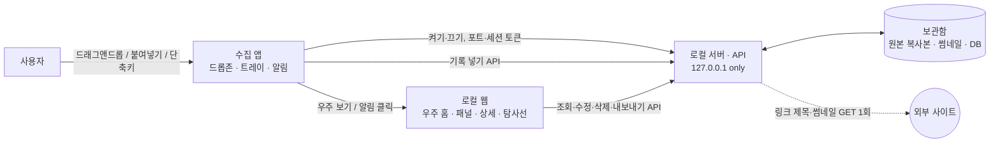

# 🌌 SpaceLog

> 팀 프로젝트 [delightPIP/teamproject](https://github.com/delightPIP/teamproject)를 바탕으로 개인 과제용으로 다시 만드는 버전이다 (팀원 동의).

> 흩어진 기록을 모아 나만의 우주로 다시 만나는 로컬 퍼스널 아카이브

맥·윈도우의 아주 가벼운 **수집 앱**으로 드래그앤드롭 한 번에 기록을 모으고, **로컬 웹의 우주**에서 한눈에 보고 둘러보며 다시 만나고, 고른 묶음을 **Claude용으로 내보낸다.**

- 수집 앱은 **모으기만**, 보기·정리·내보내기는 앱이 내 PC에 띄우는 **로컬 웹**이 맡는다.
- 기록은 **내 PC에만** 저장된다. 로그인·클라우드·텔레메트리가 없다.

> **상태**: **마감 2026-11-11 · 발표(데모) 2026-11-12 오전** · 기획 1차 초안 · 사용자 인터뷰는 이번 일정에서 하지 못함 (PRD 9장) · 구현 진행 중

---

## 🤔 왜 만드나

다운로드 폴더, 캡처, 카톡 나와의 채팅, 메모앱에 흩어 저장하기만 하고 **다시 보게 하는 장치가 없다.** 그래서 모아둔 자료와 생각이 묻히고 잊힌다.

| 근거 | 출처 |
| --- | --- |
| 사용자는 디지털로 저장한 콘텐츠를 거의 다시 보지 않는다 | Schneegass 외 2021 (N=58) |
| 찍은 사진의 70%는 다시 보지 않는다 | Popsa 2026 |
| 알림을 받으면 저장한 콘텐츠를 다시 본다 → 재발견 장치를 핵심 기능으로 | Sigethy 외 2025 |
| 사람들은 평범한 과거 기록을 다시 보는 즐거움을 과소평가한다 | Zhang 외 2014 |

자세한 근거와 공백은 [docs/RESEARCH.md](docs/RESEARCH.md) 참고.

**타깃(가정)**: PC로 일하거나 공부하며 하루에도 캡처, 문서, 링크, 메모를 많이 접하는 20~30대. 연령은 **확인하지 못한 가정으로 남는다** (인터뷰 보류, PRD 7장 Q4·9장).

---

## ✨ 핵심 기능 (MVP)

가장 중요한 두 축은 **모으기(수집 앱)** 와 **다시 만나기(재발견)** 다.

| 기능 | 어디서 | 내용 |
| --- | --- | --- |
| 🧲 **수집 앱** | 맥·윈도우 | 화면 가장자리의 작은 드롭존에 이미지·파일·링크·텍스트를 끌어다 놓거나 붙여넣기. 전역 단축키로 클립보드 즉시 저장. 넣은 직후 배정된 행성 확인·한 줄 메모 |
| 🔁 **재발견** | 수집 앱 알림 + 웹 카드 | 하루 한 번 "7일 전 오늘의 별" 알림. 누르면 우주가 그 별이 있는 행성으로 이동하고 **별 상세가 열린다** |
| 🪐 **우주** | 로컬 웹 | 기간(오늘 / 이번 주 / 직접 지정)의 우주 전체를 한눈에 조망. 행성 목록에서 바로 가기, 행성 클릭으로 들어가기. 표현 방식은 3D안(비행·착륙)으로 정했다 (Q7) |
| 🗂️ **행성 패널 · 별 상세** | 로컬 웹 | 별 목록, 행성 이름 변경·생성·삭제·합치기, 원본 미리보기·열기, 메모 수정, 행성 옮기기 |
| 🚀 **탐사선** | 로컬 웹 | 고른 별·행성·우주를 Claude 프롬프트 형식 또는 MCP 리소스 형식으로 만들어 **미리보기 후 복사** (보조 기능, 수요 검증 대상) |

### 용어

| 용어 | 뜻 |
| --- | --- |
| 기록 / 별 | 사용자가 넣은 자료 1개 (문서에서는 "기록", 화면에서는 "별") |
| 행성 | 기록을 묶는 카테고리 |
| 우주 | 로컬 웹에서 행성과 별을 보여주는 화면. 3D안으로 정했다 (Q7, 2026-11-11) |
| 재발견 | 지난 기록 하나를 골라 다시 보여주는 기능 |
| 탐사선 | 고른 기록을 Claude가 읽기 좋은 형식으로 내보내는 기능 |

### 이번에 하지 않는 것

웹에서 새 기록 만들기 · 외부 AI 자동 분류 · 검색/태그 · 원본 파일 편집 · 로그인/클라우드 동기화/백업 · 모바일 · 공유/협업 · MCP 서버 직접 조회 · Claude 자동 전송 · 자동 백그라운드 수집

---

## 🏗️ 구조



**보안·데이터 원칙** ([docs/POLICY.md](docs/POLICY.md))
- 밖으로 나가는 요청은 링크 제목·썸네일 가져오기(GET 1회) 하나뿐이다.
- 로컬 서버는 `127.0.0.1`에만 바인딩하고, Host·Origin 검사와 실행마다 새로 만드는 세션 토큰으로 다른 웹페이지의 호출을 막는다.
- 원본은 보관함에 **복사**해 저장하고, 사용자의 원래 파일은 건드리지 않는다.
- 탐사선 내보내기에는 절대 경로를 넣지 않는다.

### 기술 스택 (결정 중)

| 영역 | 후보 | 상태 |
| --- | --- | --- |
| 수집 앱 + 로컬 서버 (Q3) | **Electron + TypeScript 서버** 채택 ([ADR 0001](docs/adr/0001-collector-server-stack.md)) | 2026-11-11 채택 (PR #15). Tauri 측정은 생략(ADR 4-2). 맥·설치본 알림 클릭은 채택 후 확인 |
| 웹 + 우주 렌더링 (Q9) | [ADR 0002](docs/adr/0002-web-stack.md) 초안 (개발 B) | 개발 B·C가 1주 차 초에 확정, Q7 결정에 맞춤 |

### 폴더 구성 (SPEC 제안 · `packages/shared`, `mocks/api`는 #1로 들어옴)

```
apps/collector/     # 수집 앱 (PO)
apps/server/        # 로컬 서버·API·보관함 (개발 B)
web/                # 로컬 웹: universe · home · planet · star · probe
packages/shared/    # 공용 타입, 오류 코드, 기간 유틸
mocks/api/          # 1일 차 API 목업
docs/               # 기획 문서
```

---

## 🎯 성공 기준


| 기준 | 목표 |
| --- | --- |
| 모으기가 빠르다 | 드롭 → 저장 완료 3초 이내 |
| 한눈에 보인다 | 웹 첫 화면에서 조작 0회로 기간의 행성 전체가 보임 |
| 클릭만으로 찾는다 | 우주 홈 → 원하는 행성 패널까지 클릭 2회 이내 |
| 다시 만난다 (핵심) | 재발견 알림·카드를 연 비율 — 목표 수치 없이 데모 기간 측정만 (PRD 9장) |
| 내보내기가 빠르다 | 탐사선 열기 → 복사 완료 1분 이내 |

---

## 📁 문서 위치

| 문서 | 내용 |
| --- | --- |
| [docs/RESEARCH.md](docs/RESEARCH.md) | 문제정의 근거 리서치 |
| [docs/PRD.md](docs/PRD.md) | 기획서: 문제, 목표, 범위, 저니, 오너십, 열린 질문 |
| [docs/POLICY.md](docs/POLICY.md) | 정책서: 보안, 비즈니스 규칙, 예외 처리 |
| [docs/SPEC.md](docs/SPEC.md) | 스펙서: 화면, 데이터 모델, API, 흐름, 폴더 구성 |
| [docs/adr/](docs/adr/) | 기술 결정 기록 (0001 수집 앱·서버 스택, 0002 웹 스택) |
| [docs/INTERVIEW.md](docs/INTERVIEW.md) | 사용자 인터뷰 가이드 (**보류** — 이번 일정에 미실행) |
| [docs/DEMO.md](docs/DEMO.md) | 데모 시나리오, 인수 기준, 성공 기준 측정 방법 |
| [docs/DESIGN-REVIEW.md](docs/DESIGN-REVIEW.md) | 우주 표현 방식(Q7) 시안 검수 기준·절차·기한 |
| [site/](site/) | 받는 곳 안내 페이지 (배포하지 않음) |
